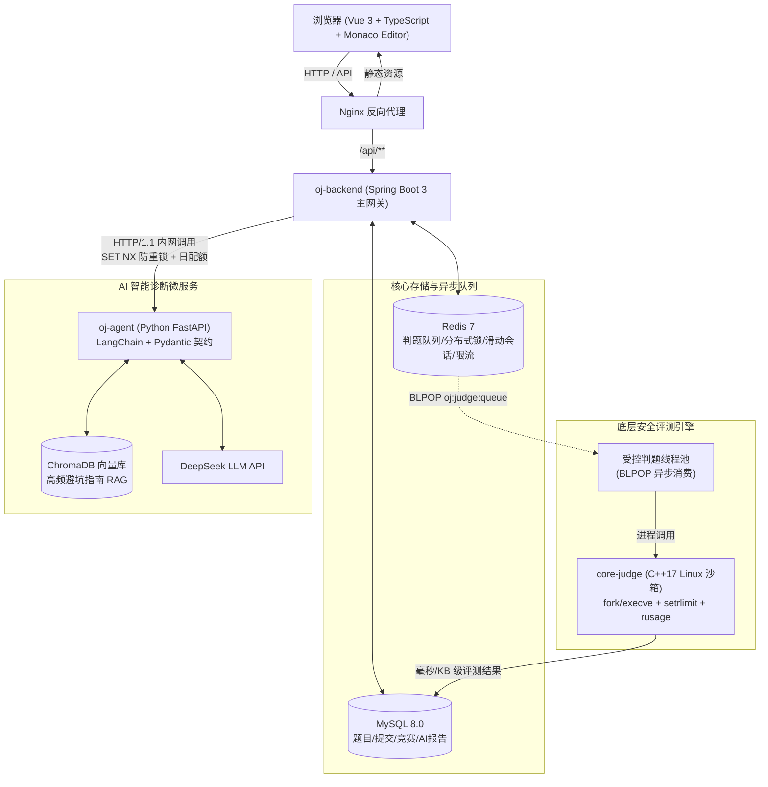
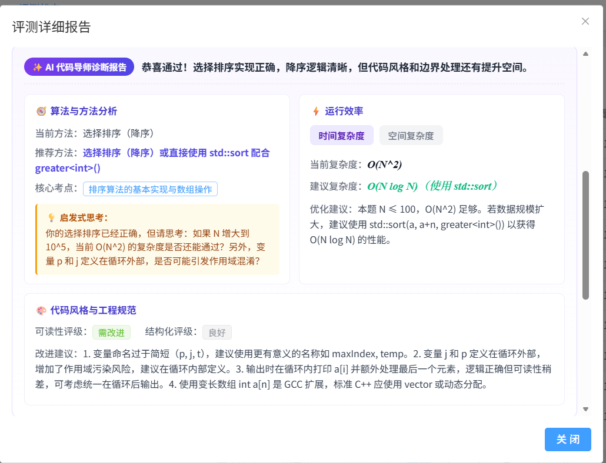
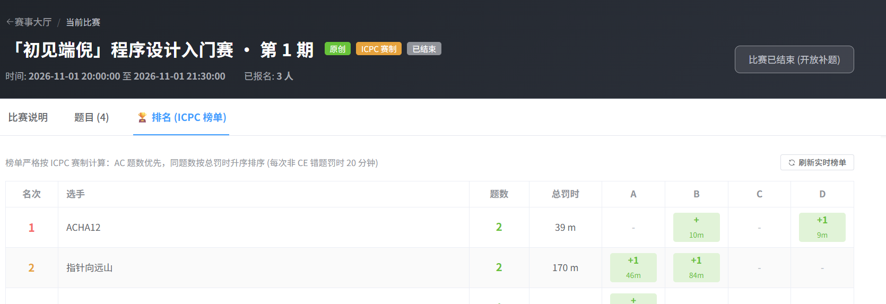

<div align="center">

# 🚀 Core OJ — 在线算法评测与智能竞赛平台

**基于 C++17 原生 Linux 沙箱 + Spring Boot 3 + Python FastAPI (RAG Agent) + Vue 3 构建的全栈在线判题与 ACM 竞赛系统**

[](https://openjdk.org/)
[](https://spring.io/projects/spring-boot)
[](https://isocpp.org/)
[](https://fastapi.tiangolo.com/)
[](https://vuejs.org/)
[](https://redis.io/)
[](https://www.mysql.com/)
[](https://www.docker.com/)

🌐 **在线体验**：[http://www.coreoj.online](http://www.coreoj.online) &nbsp;|&nbsp; 📖 **接口与架构文档**：见 `oj-backend/docs`

</div>

---

## 📌 项目简介

**Core OJ** 是一个从零独立设计、全栈自研并部署公网的在线算法评测与竞赛平台。系统不仅实现了底层操作系统级安全的 **C++17 评测沙箱**、高并发异步判题队列与 **ICPC 实时滚榜引擎**，还创新性地通过 **Java + Python 异构微服务架构** 接入了力扣同款的 **AI 代码导师（Code Mentor Agent）**，能够在代码评测后自动结合 RAG 知识库与高赞题解，输出结构化的时间/空间复杂度分析、代码风格审查与苏格拉底式启发引导。

---

## 🏗️ 系统架构设计

系统采用 **五容器异构微服务架构**（MySQL / Redis / Spring Boot / Python FastAPI / Nginx+Vue3），实现业务网关、底层沙箱与 AI 推理算力的彻底解耦：



---

## ✨ 核心技术亮点

### 1. Linux 原生安全评测沙箱 (`core-judge`)
- **隔离与流式捕获**：基于 Linux POSIX `fork/execve` 启动子进程，利用 `pipe/dup2` 异步流式捕获编译与运行输出，避免 64KB 管道缓冲写满引发死锁。
- **五重资源枷锁**：通过 `setrlimit` 严格限制 CPU 时间、运行栈、虚拟内存、输出文件大小（防磁盘写爆）以及 `RLIMIT_NPROC=1`（封死 Fork 炸弹）。
- **防挂起与精准度量**：设计「CPU 时钟 + `condition_variable` 看门狗真实时钟」双重超时机制防止 `sleep` 恶意挂起；结合 `setuid(nobody)` 最小权限降权与 `wait4(rusage)` 实现毫秒/KB 级高精度耗时与峰值内存统计。

### 2. 高并发异步判题与容灾恢复 (`oj-backend`)
- **异步削峰**：基于 **Redis List (`RPUSH/BLPOP`)** 解耦 HTTP 提交与沙箱评测，提交接口响应时间压缩至 `10ms` 以内；配合 `SET NX` 实现单用户 5 秒防刷频控。
- **受控并发与短路评测**：独立线程池严格约束沙箱并发数匹配物理核心，测试点遇到非 AC 状态立即短路终止，防止死循环算力雪崩。
- **数据一致性与零丢单容灾**：解决 `@Transactional` 事务未提交引发的异步消费竞态问题；服务启动时基于 `@PostConstruct` 自动扫描并幂等重入队滞留的 `PENDING/RUNNING` 孤儿任务，实现宕机重启零丢单。

### 3. AI 代码导师异构微服务与防刷治理 (`oj-agent` + `oj-backend`)
- **跨语言异构解耦**：Spring Boot 负责鉴权、防作弊、限流与上下文组装，Python FastAPI 作为无状态异步推理引擎负责 RAG 检索与大模型调度。
- **RAG 与结构化输出**：融合 **ChromaDB** 算法避坑向量库与本题最高赞题解上下文，通过 **Pydantic Schema + Few-Shot** 强约束输出算法思路、**独立时间/空间复杂度分析**、代码风格评级及苏格拉底式启发思考题（绝对防剧透，不直接给 AC 代码）。
- **高并发防刷与成本治理**：
  - **防作弊红线**：进行中比赛（`RUNNING`）与未公开保密题严禁调用 AI 诊断。
  - **永久幂等**：数据库 `tb_ai_analysis` 建立 `submission_id` 唯一索引，每次提交仅消耗一次算力，二次查看毫秒级回显。
  - **并发锁与日配额**：落地 Redis `SET NX` 60 秒防双击穿透锁，以及按自然日隔离的 `limit:ai:daily:{yyyyMMdd}:{userId}`（20次/天）配额限流与自动过期清理。

### 4. ICPC 实时竞赛引擎与安全权限体系
- **ICPC 实时滚榜**：基于内存状态机线性聚合计算实时排名，精准处理首次 AC 截断、未通过零罚时与 `Compile Error` 免罚时边界；支持赛前防泄题守卫与赛后一键公开题目至公共题库。
- **三级 RBAC 与会话安全**：实现 `USER / ADMIN / ROOT` 三级权限管控与 1 号元老账号防篡权内核保护；基于 Redis 实现 7 天滑动续期单点登录（SSO）与 `ThreadLocal` 上下文防内存泄漏清理。

---

## 📂 仓库目录结构

```text
oj-system/
├── core-judge/          # C++17 Linux 原生安全判题沙箱 (CMake 构建)
├── oj-backend/          # Spring Boot 3 核心业务后端 (含 docs 接口与架构规格书)
│   ├── docs/            # API 接口文档、TDD 系统详细设计规格书与 schema.sql
│   └── src/             # Controller / Service / Mapper / Async Judge Queue
├── oj-agent/            # Python FastAPI + LangChain + ChromaDB AI 代码诊断微服务
│   ├── app/             # FastAPI 路由、Prompt 工程、Few-Shot、RAG 检索与 Pydantic 契约
│   └── data/            # 知识库与 ChromaDB 向量存储目录
└── oj-frontend/         # Vue 3 + TypeScript + Element Plus + Monaco Editor 前端工程
```

---

## 🖼️ 系统界面预览

### 1. 力扣同款 AI 代码导师诊断卡片（时空复杂度胶囊切换 + 苏格拉底启发思考）


### 2. 分栏做题工作台 & 在线评测


### 3. ICPC 实时竞赛滚榜大厅


---

## 🛠️ 快速启动指南

### 环境依赖
- **数据库与缓存**：MySQL 8.0+、Redis 7.0+
- **后端与沙箱**：JDK 17+、CMake 3.16+、GCC/G++ (Linux / WSL 环境)
- **AI 微服务**：Python 3.11+、DeepSeek API Key
- **前端**：Node.js 18+

### 本地开发启动步骤

1. **编译 C++17 安全判题沙箱**
   ```bash
   cd core-judge
   cmake -B build && cmake --build build
   ```

2. **初始化数据库**
   在 MySQL 中创建 `oj_db` 数据库并导入 `oj-backend/docs/schema.sql`。

3. **启动 AI 代码诊断微服务 (`oj-agent`)**
   ```bash
   cd oj-agent
   pip install -r requirements.txt
   # 配置 .env 文件，填入 DEEPSEEK_API_KEY 与 DEEPSEEK_BASE_URL
   uvicorn app.main:app --host 127.0.0.1 --port 8000 --reload
   ```

4. **启动 Spring Boot 后端 (`oj-backend`)**
   修改 `src/main/resources/application.yml` 中的 MySQL/Redis 连接及 `core-judge` 路径后运行：
   ```bash
   cd oj-backend
   ./mvnw spring-boot:run
   ```

5. **启动 Vue 3 前端 (`oj-frontend`)**
   ```bash
   cd oj-frontend
   npm install
   npm run dev
   ```

---

## 📄 开源协议

本项目基于 [MIT License](LICENSE) 开源，欢迎 Star ⭐ 与交流！